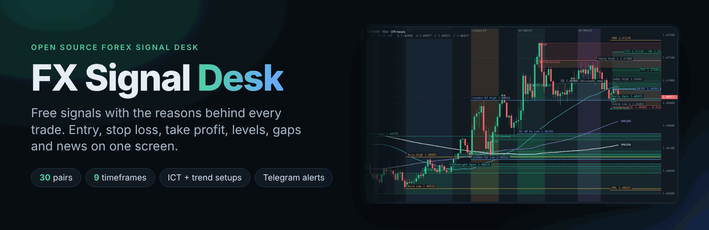
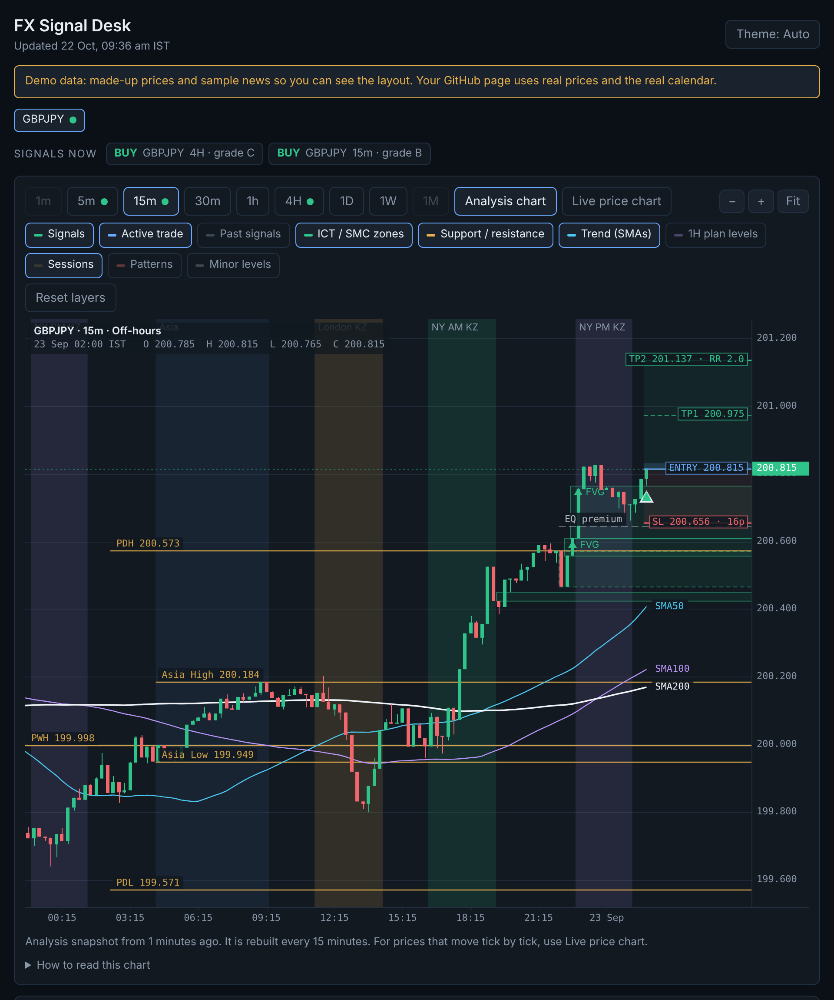
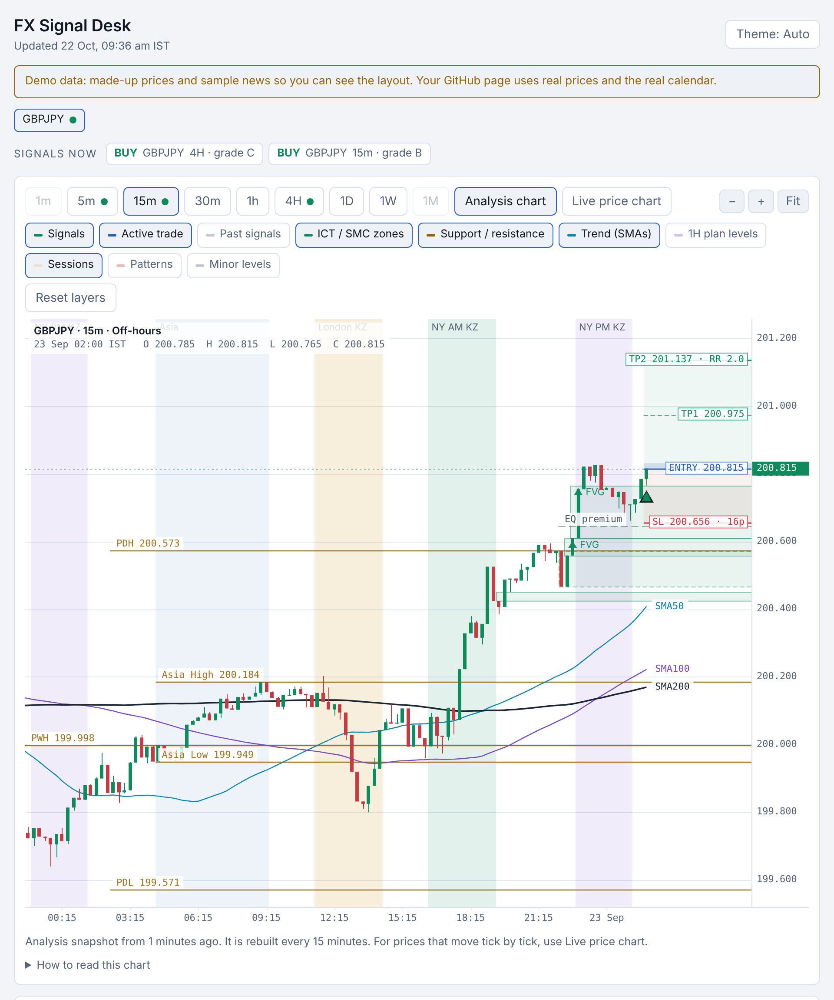
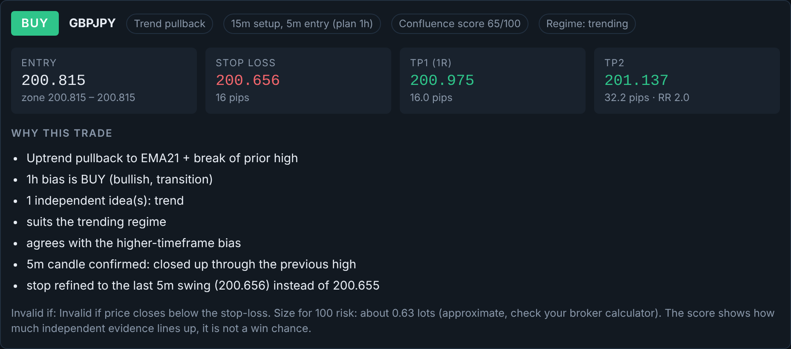
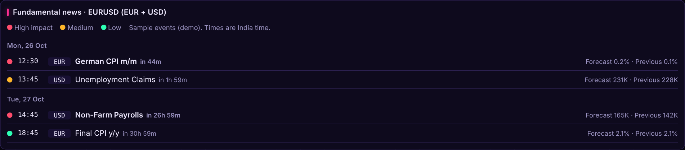
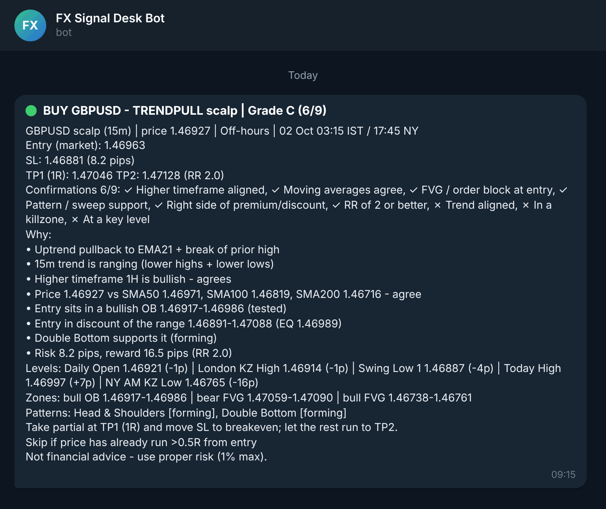
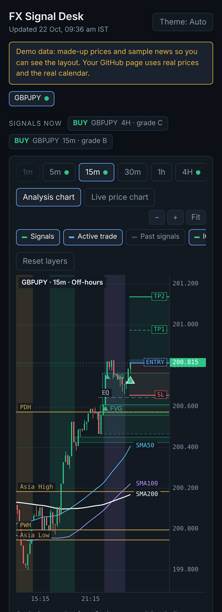
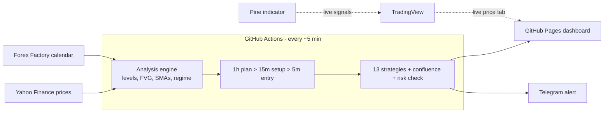
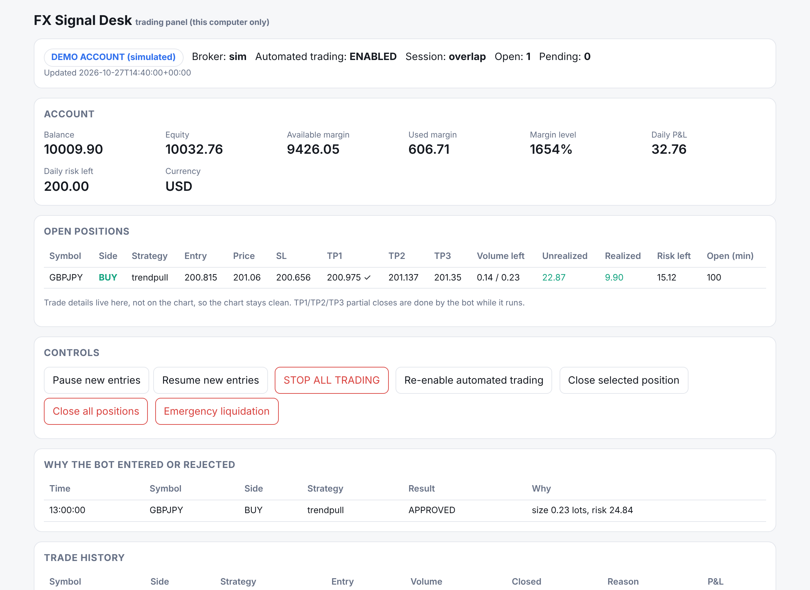

<div align="center">



<br>

[](https://github.com/luciferalive/FX-Signal-Desk/actions/workflows/ci.yml)
[](https://luciferalive.github.io/FX-Signal-Desk/)

[](LICENSE)

[](CONTRIBUTING.md)
<br>
[](https://github.com/luciferalive/FX-Signal-Desk/stargazers)
[](https://github.com/luciferalive/FX-Signal-Desk/commits/main)
[](https://github.com/luciferalive/FX-Signal-Desk/issues)


%20%C2%B7%20OANDA%20%C2%B7%20sim-8a7bff)


**A free, open-source forex signal desk. Every signal comes with entry, stop loss, take profit and the reasons behind it.**<br>
13 strategies in 7 families, a 1h plan > 15m setup > 5m entry workflow, risk checks on every signal, key levels, fair value gaps, killzones, news colours and Telegram alerts. No server, no subscription.

[**Open the dashboard**](https://luciferalive.github.io/FX-Signal-Desk/) · [**Quick start**](#quick-start) · [**Auto-trading**](#automated-trading-optional-demo-first) · [**Contribute**](#help-build-this) · [**Roadmap**](#roadmap)

</div>

---

## Why FX Signal Desk?

| | Typical signal group | Paid TradingView scripts | **FX Signal Desk** |
|---|---|---|---|
| Price | Monthly fee | Monthly fee | **Free forever** |
| Shows the reasons | Rarely | Sometimes | **Always, every signal** |
| Checks the news calendar | No | No | **Yes, with warnings** |
| You can test it on history | No | Sometimes | **Yes, one click** |
| Open source, you can change it | No | No | **Yes, MIT** |
| Runs while your PC is off | Yes | Needs TradingView open | **Yes, on GitHub** |

## What you get

<table>
<tr>
<td width="50%"></td>
<td width="50%"></td>
</tr>
<tr>
<td align="center"><sub>Dark mode: killzones, FVGs, daily / weekly levels, SMA 50 / 100 / 200 and the trade, all drawn on the chart</sub></td>
<td align="center"><sub>Light mode. One button switches Auto / Light / Dark</sub></td>
</tr>
</table>

> **Heads up:** screenshots use **made-up demo prices and sample news** so they never go stale. The live dashboard shows real data.

<table>
<tr>
<td width="33%"></td>
<td width="33%"></td>
<td width="33%"></td>
</tr>
<tr>
<td align="center"><sub>Signal card: grade, entry, SL, TP and reasons</sub></td>
<td align="center"><sub>News for the selected pair: red high, yellow medium, green low</sub></td>
<td align="center"><sub>The same signal as a Telegram message</sub></td>
</tr>
</table>

<div align="center"><br><sub>Works on a phone. Add it to your home screen.</sub></div>

## A day with the desk

1. **Weekdays, every ~5 minutes:** GitHub downloads fresh prices and the news calendar.
2. **The 1h chart plans** (bias and levels, never a trade by itself). The **15m** finds a setup that agrees. The **5m** confirms the entry.
3. **A risk check decides.** Stop size, reward-to-risk, spread, volatility and session must pass, otherwise the answer is WAIT. A pass becomes a Telegram message with entry, SL, TP and the reasons.
4. **You open the dashboard** to see the same trade drawn on the chart, with the news colour for that pair.
5. **Want proof?** Press one button to replay the rules over years of real history.

## Features

- **30 instruments:** all 28 major, minor and cross pairs, plus gold (XAUUSD) and silver (XAGUSD). Edit `pairs.txt` to change the list.
- **9 timeframes:** 1m, 5m, 15m, 30m, 1h, 4h, 1D, 1W, 1M.
- **Everything on the chart:** fair value gaps, order blocks, premium / discount, today / previous day / previous week highs and lows, Asia and session ranges, daily / midnight / weekly opens, round-number handles, SMA 50 / 100 / 200.
- **Killzones in New York time:** London, NY AM, NY PM.
- **13 strategies in 7 families** (ICT / SMC, trend, price action, breakout, mean reversion, scalping, swing). Turn each on or off in the dashboard, or run them all. Details and sources: [guides/STRATEGIES.md](guides/STRATEGIES.md).
- **Multi-timeframe workflow:** 1h plan, 15m setup, 5m execution, optional 1m precision. A lower timeframe can never override the plan.
- **Confluence without double counting:** agreement is counted per idea (family), so two breakout rules count as one vote. The 0 to 100 score is evidence, **not** a win probability.
- **Risk checks on every signal:** stop size, minimum reward-to-risk, spread, volatility, session, de-duplication, plus a lot-size suggestion. The signal engine only analyses and alerts; placing orders is a separate, opt-in layer (see below).
- **WAIT is a valid answer.** No setup means no signal, never a made-up one.
- **Clean chart:** layers you can switch on and off, merged zones, compact markers with hover details.
- **Fundamental news panel:** Forex Factory calendar filtered to the pair, coloured by impact, with a warning before high-impact releases.
- **Live chart tab:** the free TradingView widget for real-time prices.
- **Telegram alerts** with de-duplication, so you do not get the same signal twice.
- **TradingView indicator** (`pine/fx_signal_desk.pine`) for true live signals inside TradingView.
- **One-click backtest on real history:** downloads up to 3 years from Dukascopy and replays the rules with no look-ahead, spread, slippage and commission included, a conservative stop-first rule when one candle hits both, and a development / evaluation split.
- **Light and dark themes.**
- **Free hosting:** GitHub Pages and GitHub Actions. Nothing to pay for.

## Automations (all run on GitHub, all free)

| Workflow | What it does | When |
|---|---|---|
| `scan` | Looks for setups and sends Telegram alerts | Every ~5 min, Mon-Fri |
| `dashboard` | Rebuilds and publishes the web dashboard | Every ~5 min, Mon-Fri |
| `telegram-test` | Sends a test message to check your setup | Button |
| `validate` | Quick replay on recent Yahoo data | Button |
| `backtest-history` | Downloads years of Dukascopy data and replays the rules | Button |
| `ci` | Runs the tests on every change | On every push |

## How it works



## Quick start

### Path 1: the dashboard (clicks only)
1. Repo **Settings > Pages > Build and deployment > Source: GitHub Actions**.
2. Open the **Actions** tab. If asked, press **I understand my workflows, go ahead and enable them**.
3. **Actions > dashboard > Run workflow**. After about 2 minutes your page is live at
   `https://luciferalive.github.io/FX-Signal-Desk/`. On a phone, add it to your home screen.
4. It refreshes by itself about every 5 minutes on weekdays (GitHub can run it a little late).

### Path 2: Telegram alerts
1. In Telegram search **@BotFather**, send `/newbot`, pick a name and a username ending in `bot`. Copy the token.
2. Open your new bot, press **Start**, and send `hi`.
3. In a browser open `https://api.telegram.org/bot` + your token + `/getUpdates`. Copy the number after `"chat":{"id":`.
4. Repo **Settings > Secrets and variables > Actions > New repository secret**. Add `TELEGRAM_BOT_TOKEN` and `TELEGRAM_CHAT_ID`. Names must match exactly. To alert more than one person, each person presses Start on the bot, then put all their chat IDs in `TELEGRAM_CHAT_ID` separated by commas (for example `111111,222222`).
5. **Actions > telegram-test > Run workflow**. A message should arrive. After that, **scan** runs by itself every 5 minutes on weekdays.

### Path 3: test it on real history
1. **Actions > backtest-history > Run workflow**.
2. Choose a pair (for example `EURUSD`), a style (`swing`, `scalp`, `daily`) and years (`2`).
3. Wait 10 to 40 minutes, then open the run. The report is on the summary page: trades, win rate, average R, profit factor and drawdown for each grade.
4. Look for 100+ trades and a positive average R after costs. Grades A and B should beat C and D, otherwise the filter is not helping.

### Path 4: live signals inside TradingView
1. Open a chart on TradingView and the **Pine Editor** tab at the bottom.
2. Paste the contents of [`pine/fx_signal_desk.pine`](pine/fx_signal_desk.pine) and press **Add to chart**.
3. For alerts: **Add alert**, choose **FX Signal Desk**, condition **Any alert() function call**.
4. TradingView has its own Economic Calendar for news.

## Automated trading (optional, DEMO first)

An optional layer can connect to a broker, size trades from your **real equity**, run every idea through one central risk
manager, place orders and manage them to the exit. **It is off unless you run it, it starts on a DEMO account, and nothing
is proven profitable.** The strategies have no proven edge; this layer only makes execution disciplined.

<div align="center"><br><sub>The local control panel (this computer only), shown on the simulated demo account.</sub></div>

```
signal engine -> arbitration -> RISK MANAGER (only approver) -> order manager -> broker (sim | XM/MT5 | OANDA)
                                                                      |
              audit log (every decision, in plain words) <- trade manager (TP1/TP2/TP3, stops, exits, every tick)
```

| Broker | Status |
|---|---|
| Built-in simulated account (`sim`) | Implemented and fully tested. Works offline: `python -m fxbot trade demo` |
| **XM through MetaTrader 5** (`xm` / `mt5`) | Implemented, tested only against a **fake** MT5 module, **not yet against a real XM terminal**. Needs an XM **MT5** account and the MT5 terminal running on a Windows PC (`pip install -r requirements-mt5.txt`) |
| OANDA (`oanda`) | Implemented, tested only against mock responses, not a real account |

**Try it in 10 seconds (no broker, no money):**

```bash
python -m fxbot trade demo      # sizing, TP1/TP2/TP3, a spread rejection and a daily-loss lock, on a simulated account
```

**What it does for you**
- Lot size from equity x risk% and the broker's own tick value; rounded down; rejected (never inflated) if the minimum lot is too big
- Limits on total open risk, daily / weekly loss (persistent lock), positions, currency exposure, correlation, margin, spread, news, sessions and rollover
- TP1 / TP2 / TP3 partial closes, optional breakeven and trailing; a stop is never widened or removed
- Order saved before sending, timeouts resolved by asking the broker (never a blind retry), full recovery after a restart
- Manual trades you open yourself are counted in the risk and never touched
- Buttons: pause, **STOP ALL**, close one / all, emergency liquidation (`python -m fxbot trade panel`)

Demo and live are separate profiles; live is stricter, disabled by default and needs a typed confirmation every run.
Step-by-step XM demo setup, all limits, controls, failure handling and known limitations: **[guides/TRADING.md](guides/TRADING.md)**.
Credentials are never stored in the project: the bot uses the account already logged in inside your MT5 terminal,
and `trading.json` is git-ignored.

## Strategies

| Family | Strategies |
|---|---|
| ICT / SMC | Sweep + FVG |
| Trend | Trend pullback, EMA 20/60/100 cross |
| Price action | Daily pin bar / engulfing, failed-breakout fade |
| Breakout | Donchian, breakout + retest, Bollinger squeeze, NR7 |
| Mean reversion | RSI(2), Bollinger range reversion |
| Scalping | Asian range breakout (killzones) |
| Swing | Heikin-Ashi + stochastic turn |

Every rule, its source, what was vague in the sources and what was left out: **[guides/STRATEGIES.md](guides/STRATEGIES.md)**.
List them in your terminal with `python -m fxbot strategies`.

> Some rules come from a PDF book, some from widely documented techniques, and the exact numbers are this project's choice. Several are **untested**. Run `backtest-history` before trusting any of them. The Set & Forget rules are **my interpretation**, not an official copy. Know the exact rules? [Open a strategy idea.](https://github.com/luciferalive/FX-Signal-Desk/issues/new?template=strategy_idea.md)

**Choose your strategies:** in the dashboard use the strategy box, or create a `config.json` (see [`config.example.json`](config.example.json)):

```json
{
  "strategies": { "enabled": ["trendpull", "retest", "donchian", "ict"] },
  "risk": { "account": 5000, "risk_pct": 0.5, "min_rr": 2.0, "sessions": ["London KZ", "NY AM KZ"] },
  "workflow": { "use_precision": false }
}
```

| Timeframe | Signals | Analysis |
|---|---|---|
| 15m (via the 1h > 15m > 5m workflow), 5m, 1m, 4H, 1D | Yes | Yes |
| 30m, 1h, 1W, 1M | No | Yes (levels, zones, SMAs, patterns, trend) |

## Other commands

```bash
pip install -r requirements.txt
python -m fxbot strategies                        # list all strategies
python -m fxbot trade demo                        # offline walk-through of the trading layer (simulated)
python -m fxbot trade status                      # connection test for the broker in trading.json
python -m fxbot workflow --symbol EURUSD          # 1h plan > 15m setup > 5m entry
python -m fxbot analyze --symbol EURUSD --mode scalp
python -m fxbot dashboard --demo --out demo       # offline demo with made-up prices
python -m fxbot validate --symbol EURUSD --mode swing
python -m fxbot validate --symbol EURUSD --mode scalp --csv eurusd_15m.csv
python -m fxbot backtest --symbol EURUSD --strategy ict --mode swing
python -m fxbot backtest --symbol EURUSD --strategy donchian --mode daily --split 0.7   # development vs evaluation
python -m pytest -q
```

Free Yahoo data is limited (about 60 days of 15m, 2 years of 4H / daily). For longer tests use the `backtest-history` button, or a Dukascopy CSV export.

## Project layout

```
fxbot/            analysis, zones, news, scanner, dashboard, backtest
fxbot/strategies/ the 13 strategies (one file per family)
fxbot/workflow.py 1h > 15m > 5m decision;  regime.py, confluence.py, risk.py
fxbot/trading/    optional trading layer: brokers (sim, XM/MT5, OANDA), risk manager, sizing, trade manager, panel
guides/           strategy reference
fxbot/templates/  the dashboard page
pine/             TradingView indicator
tests/            pytest suite (signals, backtest, trading layer with a fake MT5)
pairs.txt         your instruments
.github/workflows CI, scan, dashboard, telegram-test, validate, backtest-history
assets/           README images
```

## Roadmap

Good first contributions:

- [ ] Exact Alex Set & Forget rules (needs someone who knows them)
- [ ] More ICT models: Silver Bullet, breaker blocks, mitigation blocks
- [ ] Order blocks in the Pine indicator
- [ ] Discord and email alerts
- [x] Longer history through Dukascopy data (`backtest-history`)
- [ ] Signal history page and performance tracker
- [ ] More tests and a bigger replay suite
- [ ] Translations
- [ ] Publish backtest results for each pair in the repo (honest numbers, committed with the code)
- [ ] Test the XM / MT5 adapter on a real XM demo account and report what needs fixing
- [ ] Prop-firm risk rules (daily loss limit, max drawdown) in alerts
- [ ] Daily pivot level layer and more strategy rules from your favourite sources

## Help build this

Contributions are very welcome, whether you code or not: strategy rules, bug reports, screenshots, docs, tests.
Read [CONTRIBUTING.md](CONTRIBUTING.md), pick something from the roadmap, and open an issue or pull request.
If it is useful to you, a star helps others find it.

**Not a coder? You can still help:**
- Send exact strategy rules you trade (use the *Strategy idea* template).
- Test it on your favourite pair and report what looked wrong.
- Share screenshots of setups that worked or failed, honestly.

[](https://github.com/luciferalive/FX-Signal-Desk/graphs/contributors)

## Disclaimer

This is an educational tool, **not financial advice**. No result is promised: there are no win-rate claims here, and
a signal is a starting point, not a guarantee. Run `validate`, paper trade first, and never risk money you cannot afford to lose.
Free data can be delayed or wrong. Never share your Telegram token.

## License

[MIT](LICENSE)
